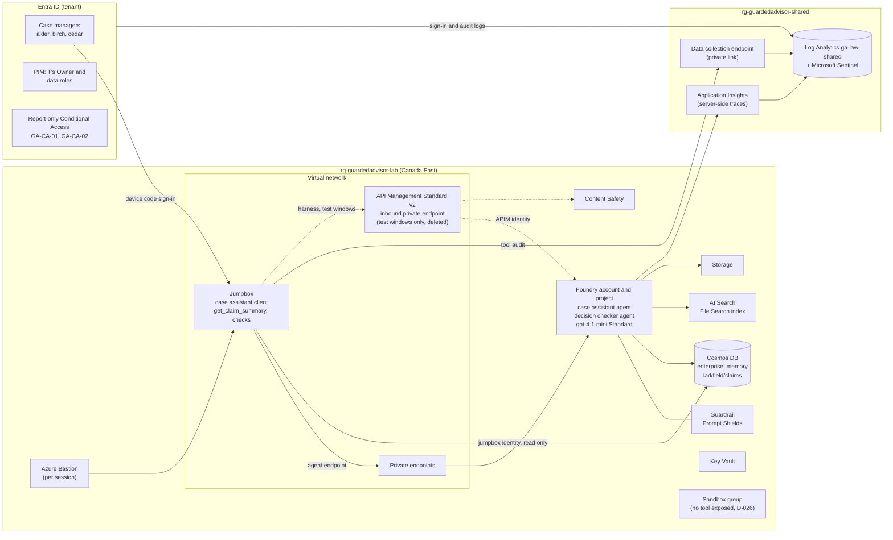

# Architecture (as built)

Draft, 2026-11-15. This describes the lab as it was built and tested. Where a component existed only for test windows, the text says so. Results are in [`docs/control-matrix.md`](control-matrix.md) and the OWASP view in [`docs/threat-model.md`](threat-model.md).

**Role codes:**
- **T:** the lab admin account. Standing Reader, plus Owner and data roles through PIM.
- **G:** a guest Global Administrator, for Entra changes.
- **E:** the emergency access account, excluded from Conditional Access.

The case managers `alder`, `birch` and `cedar` are synthetic accounts in the group `grp-larkfield-cm`.

## Diagram

Solid lines are the case assistant's path; dotted lines existed only during gateway test windows (2026-11-12 and 2026-11-13).

## Components

| Component | As built | Notes |
|---|---|---|
| Region and groups | Canada East. `rg-guardedadvisor-lab` holds the core stack. `rg-guardedadvisor-shared` holds monitoring and is never torn down mid-lab (D-011) | Residency is intake condition C5 (D-006) |
| Foundry | One account and project in the standard agent setup with private networking (forked from Microsoft's sample 15; README credits). Regional Standard deployments of gpt-4.1-mini 2025-04-14 and text-embedding-3-small 1, `NoAutoUpgrade`. Keys disabled | Approved-models and Standard-only policies (C5) |
| Case assistant agent | Prompt agent with File Search over synthetic plan wording and guidelines, and one client-side function tool, `get_claim_summary` | No write tool (C1) |
| Decision checker agent | A second prompt agent on the same deployment: temperature 0, strict JSON schema, no tools. Classifies each draft for decision language after a regex check; fails closed (D-041). Created for each test window and deleted afterwards | C1 layer 2; model inventory, "Second use" |
| Guardrail | Foundry guardrail with Prompt Shields (jailbreak and indirect attack) at user input on the model deployment | Spotlighting and tool-response checks aren't available for this agent (threat model TB2) |
| Client | `agent/case_assistant.py` on the jumpbox. Takes the caller from the validated sign-in token, checks the caseload in code, reads the claim with the jumpbox's managed identity, audits every allow and deny, and applies the regex check and the decision checker before showing a draft with its label and client-built Sources line | An allow that can't be audited isn't returned (D-022) |
| Cosmos DB | One serverless account, private endpoint only, key authentication disabled and enforced by a Deny policy. `enterprise_memory` holds the Agent Service's agent definitions and conversations; `larkfield/claims` holds the 30 synthetic claims | Conversations persist until deleted (C6 limitation) |
| AI Search, Storage, Key Vault, Content Safety | Private endpoints, public access disabled, keys off where the service allows | Outside-in check refused all data planes (findings 2026-10-15) |
| Jumpbox and Bastion | A Windows jumpbox in the virtual network, deallocated between sessions; Bastion Basic and its public IP created for each session and deleted at its end (D-018) | The jumpbox's managed identity can read every claim directly (A13; D-027) |
| API Management | Standard v2 with an inbound private endpoint and outbound virtual network integration; public network access disabled after deploy. Entra token validation, an object-ID allowlist, subscription key, `llm-content-safety` with prompt shields, `llm-token-limit`, LLM logging to `ApiManagementGatewayLlmLog`. Deployed on 2026-11-12 and 2026-11-13 for test windows, then deleted and purged | The agent's own model calls don't pass through it (threat model TB1) |
| Monitoring | Shared Log Analytics workspace `ga-law-shared` with Microsoft Sentinel, managed from the Defender portal. Custom tables `AgentToolAudit_CL`, `AdjudicationLog_CL` and `RedTeamRun_CL` through a private data collection endpoint. Entra sign-in and audit logs and the Activity log by diagnostic settings. Application Insights for server-side traces. Sentinel rule D5 deployed | `AppGenAIContent`, `AdjudicationLog_CL` and `ApiManagementGatewayLlmLog` are Protected: PIM-only reads |
| Defender for AI Services | Planned for the 2026-11-16 window (model level, prompt evidence on) | Agent-level detection needs Agent 365 (D-009) |
| Sandbox group | A Container Apps sandbox group exists, but no code execution tool is given to the agent and no sandbox runs (D-026) | Probe results under trust boundary 4 |

## Trust boundaries

1. **The gateway, where untrusted prompts enter.**
   - In the test windows, API Management checked the caller's Entra token against an object-ID allowlist, required a subscription key, ran content safety and logged prompts.
   - The case assistant's own model calls go from the client to the Foundry agent endpoint through a private endpoint, not through API Management. So the gateway's controls apply only to direct model API use.
2. **Member-submitted and retrieved content, where indirect injection arrives.**
   - Documents are wrapped in a delimiter by the client and screened by Prompt Shields at user input.
   - Tool-response screening doesn't cover File Search or client-side function tools, and spotlighting isn't supported for agents.
   - Escaped or header-line variants of an injected note got through (C3). The client's decision checks are the last layer before display (C1).
3. **The tools, where authorization is decided in code.**
   - `get_claim_summary` takes only a claim ID. The caller comes from the validated token, the caseload check runs before any read, and every allow and deny is audited.
   - **Known gap:** the tool reads Cosmos DB with the jumpbox's managed identity, which any jumpbox session can use directly. Cosmos DB logs those reads with an empty principal (findings 2026-11-15).
4. **The sandbox, where untrusted code would run.** Not in use (D-026).
   - **On the 2026-10-24 probe** (Deny with Full inspection): HTTPS was blocked and logged, but a raw TCP connect succeeded with no log entry, and whether data flows is unconfirmed.
   - **On the 2026-10-26 probe:** the sandbox showed a managed-identity endpoint to its code even with no identity attached.
   - The sandbox data plane is reached over the internet by design of the service.

## Identity

| Principal | Holds | Notes |
|---|---|---|
| T | **Standing:** Reader at the subscription plus narrow lab roles (for example Foundry User on the project). **PIM-eligible:** Owner, Privileged Monitoring Data Reader, the sandbox data role, Security Administrator (until 2026-11-17) and Security Reader | No standing Owner (D-030) |
| G | Global Administrator (guest) | Entra changes: accounts, Temporary Access Pass, Conditional Access support |
| E | Global Administrator, excluded from Conditional Access | Emergency access; never named in the repository |
| Case managers | Foundry Agent Consumer on the project, through `grp-larkfield-cm`, assigned only for a test window; accounts disabled between windows | Report-only GA-CA-01 and GA-CA-02 target the group |
| Jumpbox managed identity | Cosmos DB Built-in Data Reader on `larkfield/claims`; ingestion to the data collection rules | The A13 gap |
| Project managed identity | The standard setup's roles on Cosmos DB, AI Search and Storage | Broader than needed on Storage and AI Search (findings 2026-11-11) |
| APIM managed identity | Cognitive Services User on Content Safety; Cognitive Services OpenAI User on the Foundry account (test windows only) | Removed with the instance |

## Future packs

These are design notes only; nothing here is built for pack 1 (D-012, D-013).

**Multimodal payloads.** The red-team harness will accept image and audio payloads as well as text and documents, because packs 2 and 3 test deepfaked voice, synthetic images and forged evidence. Each payload is stored in the pack's `attacks/` folder and referenced by path, never embedded in a script. Every run writes the same ground-truth row to `RedTeamRun_CL` with two extra fields, `payload_type` (`text`, `document`, `image`, `audio`) and `payload_sha256`, so a result can be traced to the exact media used. Synthetic media depict fictional personas only, never a real person.

**Approval-gated write actions.** Pack 1 has no write tools (C1). Later packs need agents that can change something, such as resetting a credential or dispatching a truck, without being able to do it on their own. The tool layer leaves room for a separate class of write tools that can only stage a change; nothing is applied until a human approves it. The approval is bound to a hash of the exact staged change, so any change after approval invalidates it. Each approval is single-use and expires after a short time. The approver must be a different identity from the requester. Approvals arrive through a channel the agent can't write to, so the agent can't forge or relay its own approval. The entitlement check and the audit log (`AgentToolAudit_CL`, generic fields) apply both when the change is staged and when it's applied. This is the control that the forged and replayed approval tests and the synthetic authority (deepfaked approver) tests in packs 2 and 3 will target.
